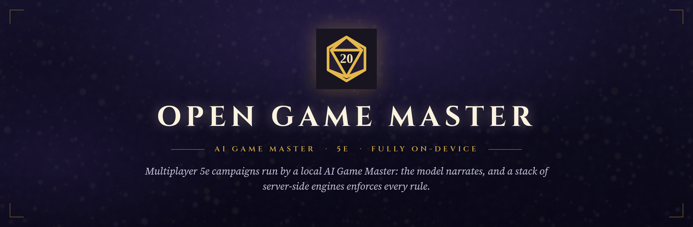
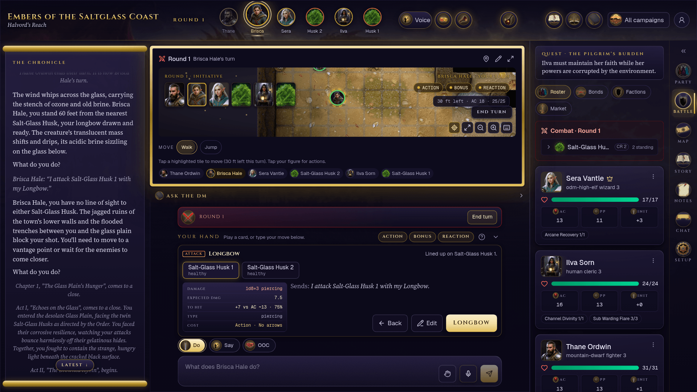
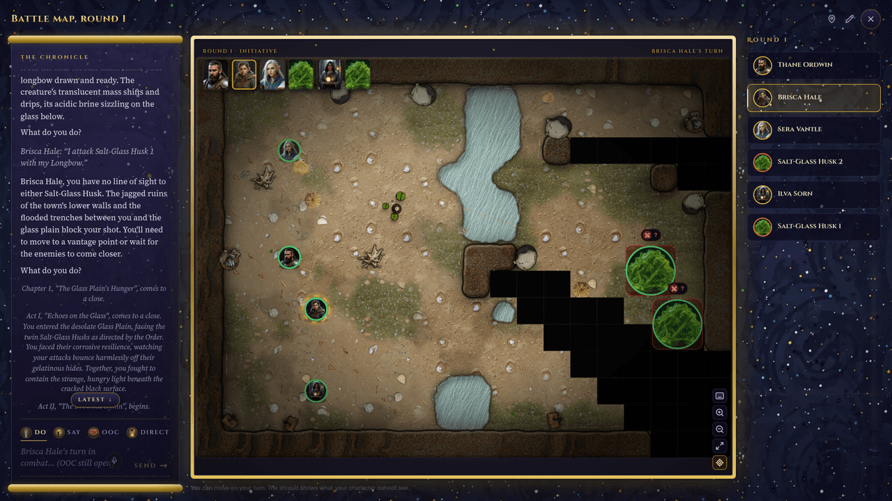
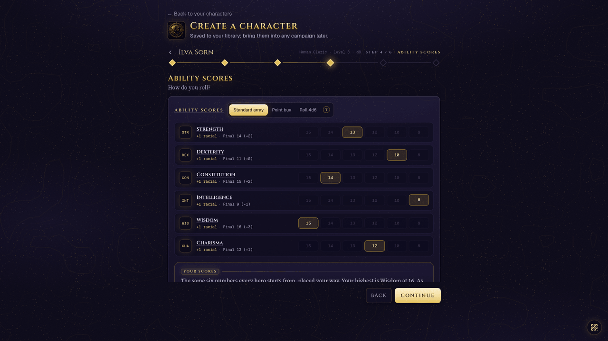
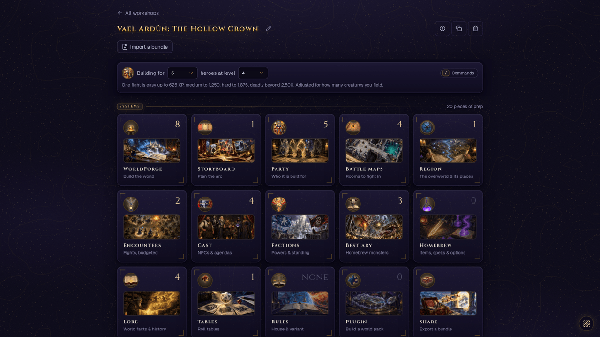
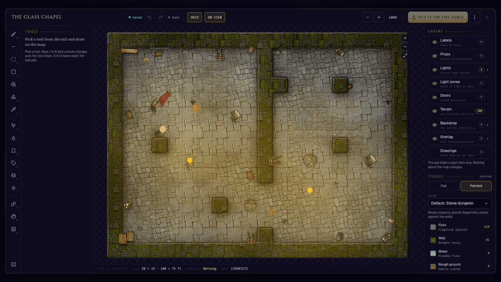
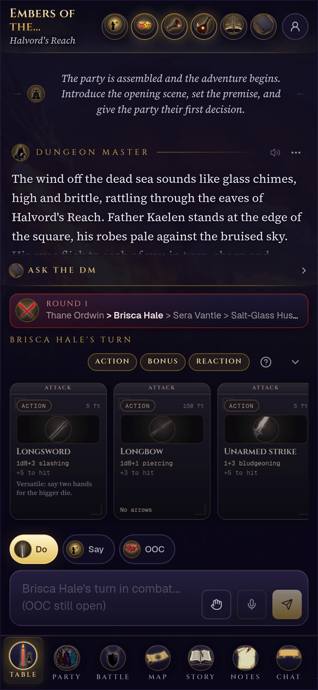

<div align="center">



<br>

[](https://hub.docker.com/r/lebbi/open-dungeon-master)
[](https://github.com/Lebbitheplow/open-dungeon-master-client/releases)
[](https://github.com/Lebbitheplow/open-dungeon-master/releases)
[](https://github.com/Lebbitheplow/open-dungeon-master/releases/latest)
[](https://github.com/Lebbitheplow/open-dungeon-master/stargazers)
[](https://discord.gg/B2tQFr3TYD)

[](LICENSE)
[](package.json)
[](docs/rules-coverage.md)
[](docs/install.md#requirements)
[](docs/install.md#requirements)
[](#)

</div>

**Open Dungeon Master** runs multiplayer (and solo) Dungeons &amp; Dragons 5e
campaigns with an AI Dungeon Master, on your own machine. The narrator is whichever
AI you already have: **a local model** (llama.cpp, Ollama, LM Studio, vLLM), **an
API key** (OpenAI, OpenRouter, or any OpenAI-compatible endpoint), or **a CLI agent
you already pay for** (Claude Code, Codex, opencode, Grok Build), which narrates on
its own subscription with no API key handed over. The model is the creative mind
and narrator; a stack of server-side engines enforces the 5e rules for both the
players and the DM. **The narrator never owns the numbers**: dice, hit points, spell slots, conditions, and the death track are computed and
clamped by the backend, and the model changes game state only through tools the
server validates.

The AI drives the session, requesting rolls, starting encounters, and playing NPCs
and companions, following a secret story arc it regenerates as the campaign moves.

<div align="center">

### Your turn, in cards



<sub><i>A live session of <b>Embers of the Saltglass Coast</b>. Your hand holds every action the sheet allows, each card says what it rolls and what it costs, and the server does the rolling. The battle map, the turn order and the party sit around it.</i></sub>

<table>
<tr>
<td width="50%" align="center"><br><sub>The battle map, fogged and in initiative</sub></td>
<td width="50%" align="center"><br><sub>The character builder, placing ability scores</sub></td>
</tr>
<tr>
<td width="50%" align="center"><br><sub>The workshop, where prep lives</sub></td>
<td width="50%" align="center"><br><sub>The map studio: paint it, light it, put it on the table</sub></td>
</tr>
</table>



<sub><i>The same table on a phone. The apps compile these pages into native screens.</i></sub>

</div>

## What's in the box

<table>
<tr>
<td width="50%" valign="top" align="center">
<br>
<b>The multiplayer table</b><br>
<sub>Create a campaign, share an invite code, ready up in the lobby, and play in real time (SSE live updates) with a party lead who steers settings, rolls and turn order. Solo play runs the same engines.</sub>
</td>
<td width="50%" valign="top" align="center">
<br>
<b>Your AI Dungeon Master, your choice</b><br>
<sub>A local model (llama.cpp, Ollama, LM Studio, vLLM), an API key (OpenAI, OpenRouter, any OpenAI-compatible endpoint with tool calling), or a CLI agent subscription you already have: Claude Code, Codex, opencode or Grok Build. Whichever narrates, it makes the creative calls and never states a roll or edits its own numbers.</sub>
</td>
</tr>
<tr>
<td width="50%" valign="top" align="center">
<br>
<b>Server-enforced 5e rules</b><br>
<sub>Initiative and action economy, server-resolved attacks and crits, spell slots and upcasting, the full condition table, short/long rests, AC and progression — all clamped and audit-logged.</sub>
</td>
<td width="50%" valign="top" align="center">
<br>
<b>Secret story arc &amp; maps</b><br>
<sub>A hidden spine (premise, stakes, antagonist, ordered beats) refreshed as chapters close and editable a beat at a time, a live quest log, rolling-summary memory, and procedural fog-of-war battle maps.</sub>
</td>
</tr>
<tr>
<td width="50%" valign="top" align="center">
<br>
<b>Characters &amp; companions</b><br>
<sub>Structured SRD 5.1 sheets, 48 classes and 49 backgrounds, a guided creation wizard and level-up flow, and full AI companions with real sheets that auto-level with the party.</sub>
</td>
<td width="50%" valign="top" align="center">
<br>
<b>Battle maps &amp; scene art</b><br>
<sub>Optional ComfyUI drives character portraits, inline scene art and top-down battle maps with per-character line of sight. Missing? It fails soft to a placeholder.</sub>
</td>
</tr>
<tr>
<td width="50%" valign="top" align="center">
<br>
<b>On-device &amp; encrypted</b><br>
<sub>All state lives in a local SQLite database, encrypted at rest. No accounts in the cloud, no telemetry — username/password auth (optional Discord), with an admin panel and undoable audit log.</sub>
</td>
<td width="50%" valign="top" align="center">
<br>
<b>Session tools</b><br>
<sub>Live voice chat with proximity rules and side rooms, dynamic ambience and music, private whispers and side chats, a 3D dice tray plus physical and Pixels Bluetooth dice, TTS narration, push-to-talk, and an installable PWA layout.</sub>
</td>
</tr>
<tr>
<td width="50%" valign="top" align="center">
<br>
<b>Run the table yourself</b><br>
<sub>A human-DM mode where a person narrates (usually over the voice chat) and the app keeps sheets, dice, maps and the record straight, with a DM console, story-beat capture, and an assisted mode that delegates monsters, read-alouds or a covered absence to the AI.</sub>
</td>
<td width="50%" valign="top" align="center">
<br>
<b>Workshop prep space</b><br>
<sub>Author maps in a graphical terrain editor, bosses with derived CR, NPCs, encounters, roll tables, lore and storyboards outside any campaign, then import them into new campaigns; workshops, campaigns, characters and individual assets all clone.</sub>
</td>
</tr>
</table>

## How it works

- **The engines own the rules.** The model narrates and makes creative calls, but
  it can only touch game state through server tools that are clamped, audit-logged,
  and published live to every player. It treats player messages as intent, not
  outcome.
- **The AI drives the table.** It asks the server for rolls, starts and runs combat,
  plays NPCs and AI companions, moves the party, and decides when to spotlight
  specific players for input.
- **It follows a secret story arc.** Every campaign gets a hidden spine that
  advances as chapters close; player-safe pieces surface as the quest log.

The fifty-odd engines behind this: [docs/engines.md](docs/engines.md). What is
enforced and what is guidance: [docs/rules-coverage.md](docs/rules-coverage.md).

## Quick start

You need **Node 22.18+, 24 or 26+** (or Docker) and **a storyteller**: a local
model server such as llama.cpp or Ollama, an API key (OpenAI, OpenRouter or any
OpenAI-compatible provider), or a CLI agent you already pay for (Claude Code,
Codex, opencode, Grok Build). Pictures and voice are optional.

A local model needs a **context window of at least 16K tokens to narrate and
24K to run fights; 32K or more is recommended**. The default storyteller runs
at 64K, and the guided setup's **Test backend** reads the window a server runs
([what each size plays](docs/text-backends.md#context-window)). Hosted models
and agent programs have far more.

```bash
git clone --depth 1 -b stable https://github.com/Lebbitheplow/open-dungeon-master.git
cd open-dungeon-master
npm install
npm run setup        # database key, content pack, memory model, production build
npm run start:lan    # 0.0.0.0:3005 so your party can reach it on the LAN
```

The server prints a link with a one-time setup code. Open it on the same
computer, create the admin account, and the **guided setup** finds what is
running on the machine and walks through the storyteller, pictures, voice,
players and your own agent, one question at a time.

With Docker instead:

```bash
curl -O https://raw.githubusercontent.com/Lebbitheplow/open-dungeon-master/stable/docker-compose.yml
docker compose up -d        # http://localhost:3005
```

Both follow the stable releases. Nightly betas, and how a beta becomes stable:
[docs/releases.md](docs/releases.md).

## Documentation

- **Getting started**
  - [Install and first run](docs/install.md): requirements, the guided setup, setup by hand, the first admin account, the content pack, tests
  - [Run with Docker](docs/docker.md): the image, reaching AI services on the host, volumes and maintenance, publishing
  - [Backups and moving to another server](docs/backup-restore.md)
  - [Releases and update channels](docs/releases.md): stable, the nightly betas, and how a beta is promoted
- **The storyteller**
  - [Text backends](docs/text-backends.md): the recommended DM model and its settings, Ollama, choosing a model (the models.dev catalog, no model named in code), OpenAI and other APIs, long-story memory
  - [Agent programs as the DM](docs/agent-harness.md): Claude Code, Codex, opencode and Grok Build on their own sign-in
- **Pictures, voice and sound**
  - [Setting up pictures, narration and dictation](docs/media-setup.md): ComfyUI, an OpenAI key, Kokoro, Whisper
  - [Image generation](docs/image-generation.md): the image models, measured hardware, AMD GPUs
  - [Voice chat and real dice](docs/voice-and-dice.md): live voice with turn-taking and proximity, physical and Pixels dice
- **Running a server**
  - [Settings, admin panel and sign-in](docs/server-admin.md): which setting wins, the admin panel, Discord sign-in
  - [Configuration reference](docs/configuration.md): every environment variable, phones, sharing a server, ambience
  - [Storage and the single-writer rule](docs/storage.md): the encrypted database, one process per database, changing the embedding model
  - [Player agents and webhooks](docs/player-webhooks.md): a player's own agent, woken on its turn
  - [Multiple characters per player](docs/multi-character-players.md)
- **Content and worlds**
  - [Campaign plugins (world packs)](docs/worlds.md): renaming the rules into a setting, the registry, building a pack in the workshop
  - [Workshop portability](docs/workshop-portability.md): bundles, imports and shared workshops
  - [The content pack](docs/content.md) and [licenses](docs/LICENSES.md)
- **Addons**
  - [Addons](docs/addons.md): installing from the audited list, permissions, where addons run
  - [Writing an addon](docs/addons/authoring.md), [the extension points](docs/addons/extension-points.md) and [the catalog guidelines](docs/addons/guidelines.md)
  - [Working on the addon framework](docs/addons/framework.md): the code map, the rules it keeps, how to add a field, a message or an extension point
- **How it works**
  - [The engines](docs/engines.md): combat, sheets, world simulation, narrative, memory, AI integration, the human DM and the workshop
  - [Rules coverage](docs/rules-coverage.md): what is enforced, what is guidance, what is out of scope
  - [Roadmap](docs/ROADMAP.md)

## Credits and licenses

**The application is [MIT licensed](LICENSE). Third-party and unofficial campaign
content is not included with this repository and is not covered by the MIT license.**
Community world packs are installed at runtime into the gitignored `data/worlds/`
directory. They are the work of their own authors, distributed by whoever
publishes them, and are neither shipped nor vetted by this project. A pack that
references an existing setting is an unofficial fan work with no affiliation with
or endorsement from that setting's rights holders, and the app labels it as such
wherever it appears. Only original works are bundled in this repository.

- The workshop's WorldForge tool is ported from WorldForge, Smoebo's
  world-building app, with their permission. What came from it is listed in
  [docs/LICENSES.md](docs/LICENSES.md).
- Game rules data derives from the System Reference Document 5.1 by Wizards of the
  Coast LLC, licensed under CC-BY-4.0. See [docs/LICENSES.md](docs/LICENSES.md).
- Expanded options (the widely played subclasses, spells, feats and lineages that no
  open dataset carries) are original content: the mechanics are stated in our own
  wording, and no publisher's descriptive text is reproduced.

<sub>Dungeons &amp; Dragons and D&amp;D are trademarks of Wizards of the Coast LLC. This
project is not affiliated with, endorsed, or sponsored by Wizards of the Coast.</sub>
